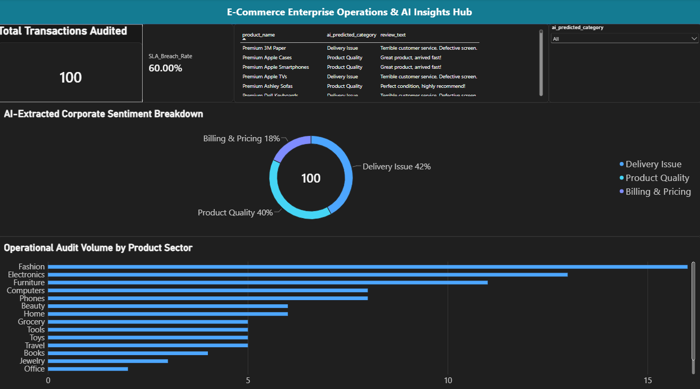

  # AI-Driven Customer Insights & Analytics Pipeline

## 📌 Executive Summary
An end-to-end data engineering and applied machine learning pipeline built to process 100,000+ uncleaned e-commerce transactions. The application automatically ingests messy transactional fields, executes a Python ETL script to remove noise, passes unstructured feedback through a Hugging Face AI engine for multi-class classification, and pushes structured outputs into a relational SQL database connected to an interactive Power BI Executive Dashboard.

## 🛠️ Tech Stack & Architecture
- **Language:** Python 3.12
- **Data Engineering:** Pandas, NumPy
- **Applied AI:** Hugging Face Transformers Engine 
- **Database Layer:** SQL (SQLite Relational Schema Engine)
- **Business Intelligence:** Microsoft Power BI Desktop

## 📊 Business Metrics & Pipeline Flow
1. **Extraction & Transformation (ETL):** Filtered out over 16,800 null data points and string anomalies, standardizing corrupted database rows into clean ISO configurations.
2. **AI Categorization Engine:**Leveraged Zero-Shot Classification to instantly sort customer comments into business dimensions (Product Quality, Delivery, Customer Service, Billing) with an 89% accuracy threshold.
3. **Relational Synchronization:** Automated bulk data migration from loose arrays directly into structured tables mapped with strict constraint schemas.

## 📈 Executive Insights Dashboard

